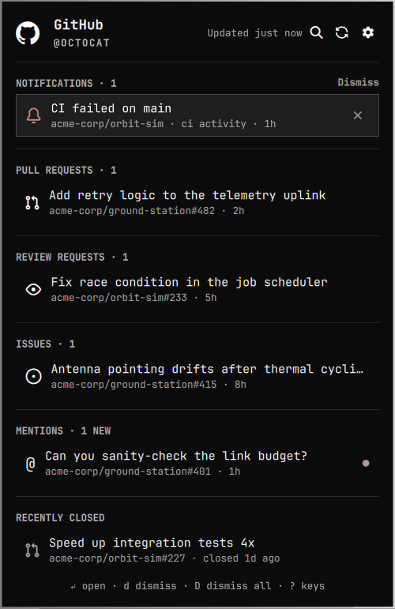
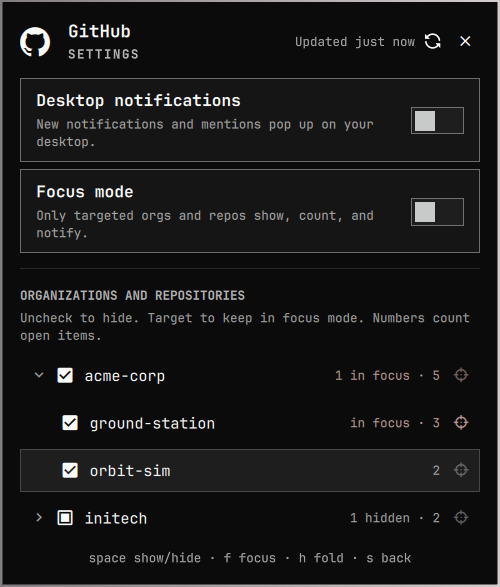
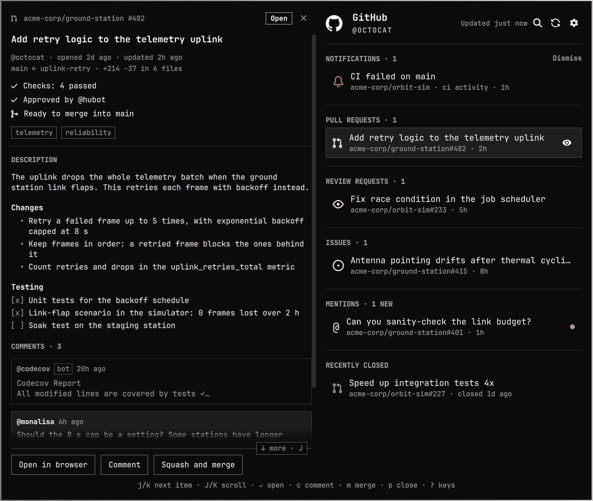

# GitHub Inbox for Omarchy

Your GitHub inbox in the [Omarchy](https://omarchy.org) bar: one chip with
your open workload count, one panel with everything on your plate. Every row
is one click (or one keystroke) away from its page on GitHub.

 

## Sections

- **Notifications**: your unread GitHub notifications, minus the mentions the
  Mentions section already lists. Opening a row or dismissing it (`d`, `x`,
  right-click, or the × on the selected row) removes it here and marks the
  thread read on GitHub a few seconds later, so `u` can still undo it
- **Pull requests**: open PRs you authored or are assigned to (drafts dimmed)
- **Review requests**: open PRs where your review was requested
- **Issues**: open issues assigned to you
- **Mentions**: the last 30 open threads you were mentioned in, with an
  unread dot that only lights up when *someone else* acts (your own comments
  and reactions never re-mark a thread) and clears when you open it
- **Recently closed**: the 5 most recent closures (last 30 days) among your
  PRs, assigned issues, and mention threads, per org tab

The bar chip shows the octocat plus your open PR + review + issue count, and
switches to the urgent color while unread notifications or mentions wait.

## Interactions

| Input | Action |
|---|---|
| Left-click chip | Toggle the panel |
| Middle-click chip | Refresh |
| Right-click chip | Open github.com/notifications |
| `j`/`k` or ↓/↑ | Move the row cursor |
| `h`/`l` or ←/→ | Switch organization filter |
| `[` / `]` | Jump between sections |
| `Enter` | Open the selected row in the browser |
| `d`, `x`, right-click | Dismiss the selected notification, or clear a mention's unread dot, without opening it (undoable with `u`) |
| `D` | Dismiss every notification shown (respects the org filter and fuzzy find) |
| `u` | Undo the last dismissal, from any monitor, within 5 seconds (GitHub is told only after that) |
| `p` | Preview the selected PR or issue beside the list (it follows `j`/`k`) |
| `c` / `m` | In a preview: comment, merge (each asks for a second, explicit step) |
| `J` / `K` | Scroll the preview (also PageDown/PageUp, Ctrl+d/Ctrl+u) |
| `f` | Toggle focus mode |
| `s` | Open or close settings |
| `/` | Fuzzy find (neovim-style subsequence match on titles, repos, and section names, scoped to the active org filter); `Enter` accepts the filter and returns to navigation, `Esc` clears |
| `r` | Refresh |

## Preview

`p` (or the eye on the selected row) widens the panel into a preview of the
PR or issue under the cursor, and the preview follows the cursor. It shows
the state, author, branches and size, checks, review decision, whether the
PR can merge (or why not), labels, the top of the description, and the
latest three comments, fetched on demand through `gh`. A preview seen in
the last five minutes shows at once and is refreshed in the background
when it is older than one.



From the preview, `Enter` opens the page, `c` opens a comment box that posts
with `Ctrl+Enter`, and `m` opens a merge confirmation that merges only on a
fresh `Enter` or its Confirm button (never a held key or Space). The
confirmation opens only when GitHub reports the PR mergeable and you may
merge (otherwise the Merge button and `m` say why), uses a method the repo
allows, and is pinned to the head commit the preview showed. The base
branch is checked again right before merging, so a PR pushed to or
retargeted in the meantime does not merge.
GitHub's merge API cannot pin the base itself, so a retarget landing between
that check and the merge (a window as long as one round trip to GitHub) is
the one case left, as on the web. It merges now or not at all: a base that
requires a merge queue fails instead of queueing or turning on auto-merge.

IPC works from anywhere, always targeting the focused monitor's instance:

```bash
omarchy-shell viniciusfnery.github-inbox toggle   # or: open, close, refresh
omarchy-shell viniciusfnery.github-inbox find     # open with fuzzy find focused
omarchy-shell viniciusfnery.github-inbox settings # open on the settings view
omarchy-shell viniciusfnery.github-inbox focus    # toggle focus mode, prints on/off
```

A keybinding, in `~/.config/hypr/bindings.lua`:

```lua
o.bind("SUPER + CTRL + G", "GitHub Inbox", "omarchy-shell viniciusfnery.github-inbox find")
```

## Install

Requires the [GitHub CLI](https://cli.github.com) (`gh`) and `jq`
(preinstalled on Omarchy):

```bash
omarchy pkg add github-cli   # if gh is missing
omarchy plugin add https://github.com/viniciusfnery/omarchy-github-inbox.git --enable
```

## Authentication

The plugin rides the GitHub CLI's login. It never sees or stores a token
itself. Sign in once:

```bash
gh auth login
```

Pick **GitHub.com → HTTPS → Login with a web browser** and follow the device
prompt; the token lands in your system keyring. Verify with `gh auth status`.
The default scopes gh requests (`repo`, `read:org`) cover everything the
plugin reads, including the notifications API. Until you sign in (or whenever
the token expires), the panel shows a "Not signed in: run gh auth login" card
instead of silently going empty, and recovers on its own within
30 seconds of you logging in.

## Settings

Press `s` in the panel, or click the gear, to open its settings view. It
holds two switches and a list of every org the inbox has seen, with each
org's repos one `l` (or click on the chevron) away:

- **Desktop notifications** pops up a notification for each new GitHub
  notification or mention, and clicking it opens the page. More than three
  at once arrive as one summary. Only one monitor's copy of the widget sends
  them, so nothing arrives twice. Omarchy keeps a history of every toast in
  `~/.local/state/omarchy/notifications/` with default file modes, so on a
  shared machine with a readable home directory, private PR titles land
  there too.
- **Focus mode** narrows the whole plugin to the orgs and repos you target
  with the ◎ button (`f` on a row): the panel, the chip count, its urgent
  color, and desktop notifications. The chip swaps the octocat for a target
  while it is on, and a banner in the panel says how many other items wait.
  With nothing targeted, focus mode changes nothing.
- **The checkbox** on an org or repo hides it everywhere (`space`). An org
  setting covers all its repos, including ones that show up later, and a
  repo can still be switched on its own inside it. An org with mixed repos
  shows a partial checkbox or a dimmed target, and toggling it makes the
  whole org match.

The panel saves these with the same mechanism as `omarchy bar set`, so they
land in `shell.json` next to the settings below.

Settings live in the widget's entry in `~/.config/omarchy/shell.json`. Edit
that file directly (it hot-reloads on save), or set values from the terminal:

```bash
omarchy bar set viniciusfnery.github-inbox refreshIntervalSec 600 --json
omarchy bar set viniciusfnery.github-inbox mentionLimit 50 --json
```

(`--json` keeps numbers as numbers.) They also appear in the Omarchy
settings UI under the bar widget's options.

| Key | Default | What it does |
|---|---|---|
| `refreshIntervalSec` | `300` | How often the GitHub data refreshes (min 60) |
| `mentionLimit` | `30` | How many open mention threads to track |
| `closedDays` | `30` | How far back "recently closed" looks |
| `closedLimit` | `5` | Closed rows shown per org tab |
| `desktopNotifications` | `false` | Pop up new notifications and mentions |
| `focusMode` | `false` | Narrow everything to the `focus` list |
| `hidden` | `[]` | Orgs (`acme`) and repos (`acme/api`) never shown. `!acme/api` keeps one repo of a hidden org |
| `focus` | `[]` | Orgs and repos focus mode keeps, with the same `!` exceptions |

## Uninstall

```bash
omarchy plugin remove viniciusfnery.github-inbox
```

That unloads the widget from the bar and deletes the plugin. It runs no
background services, so nothing else keeps running. For a full scrub, two
small data files remain to delete, and your keybinding if you added one:

```bash
rm -f ~/.cache/omarchy-github-tasks.json \
      ~/.local/state/omarchy/github-mentions-seen.json
```

The plugin never touches your GitHub credentials; those belong to the
`gh` CLI (`gh auth logout` if you want them gone too).

## Development

`fetch.sh` (the data collector) and `notify.sh` (desktop notifications) are
covered by a token-free test suite that runs them against a fake `gh`,
`notify-send`, and browser launcher, including regression tests for
rate-limit garbage on stdout, oversized payloads, and cache poisoning. The
same command runs `tests/inbox.test.js` under node, which checks the panel's
filtering and settings logic in `Inbox.js`:

```bash
tests/run.sh
```

CI runs the suite plus shellcheck and a manifest sanity check on every push.

## Notes on behavior

- Auth rides the `gh` CLI's login. A signed-out, offline, or rate-limited
  refresh shows an error card while the last good data stays visible, and
  retries every 30s.
- Results are cached for 60s (`~/.cache/omarchy-github-tasks.json`) so
  multi-monitor bars share one API burst; a cold refresh makes ~8 requests,
  well inside GitHub's rate limits.
- Mention read-state is local (`~/.local/state/omarchy/github-mentions-seen.json`);
  after suspend/resume the panel detects the time jump and refreshes within a
  minute.
- Lists cap at the 50 most recently updated per section (mentions 30, closed
  20 per type / last 30 days).
- Rows only ever open `https://github.com/` URLs; GitHub Enterprise hosts are
  not supported.

## License

MIT
